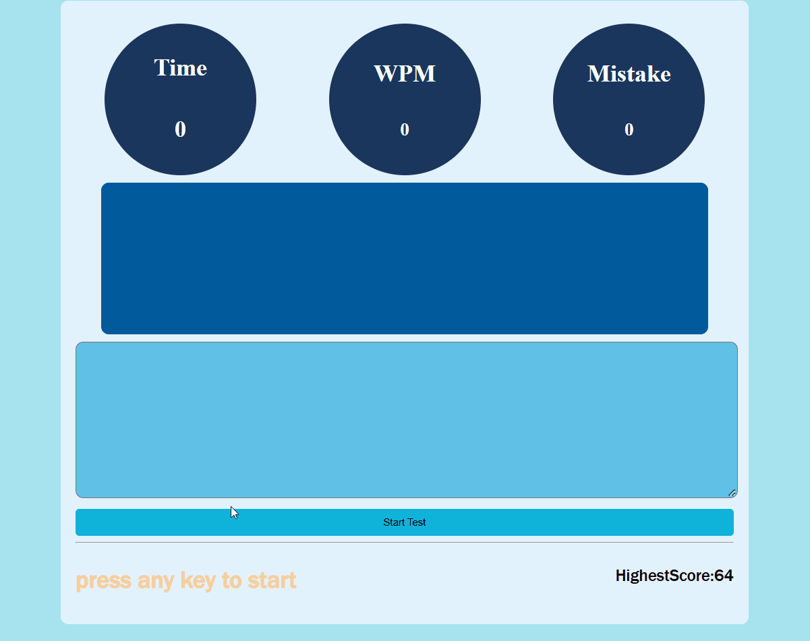
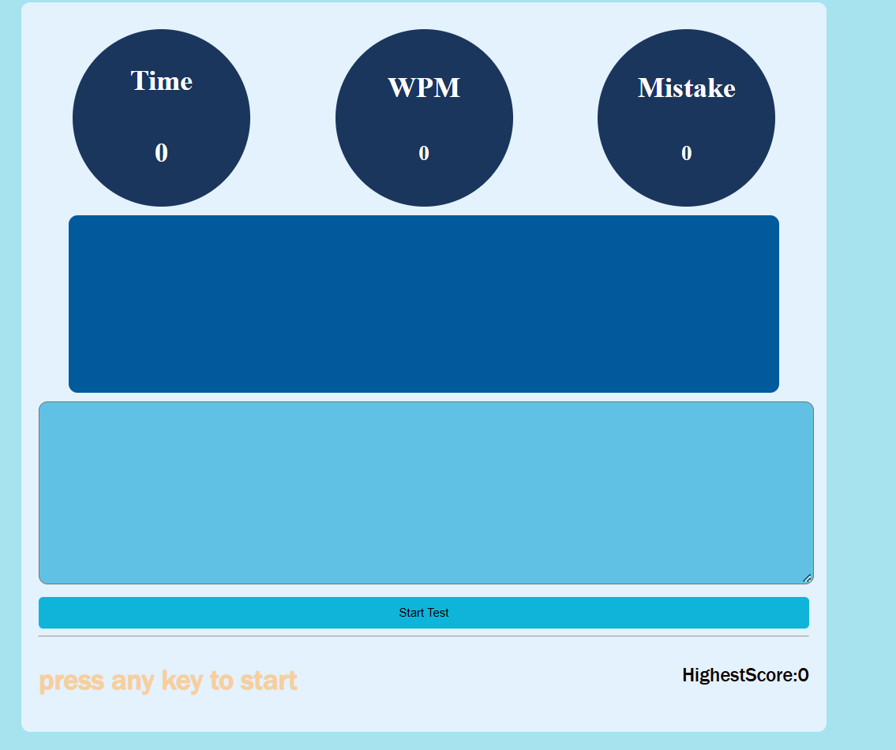

# Typing-practice
A site where people can test their typing speed.people have to type the word from given paragraph.

here's an AWESOME gif of my project!
;

## HOW THIS WAS MADE
I made this because i love typing and i used other site for improving my typing daily. and i think i should also make one simple site for the typing using my tech stack (html,css,js).

## What does it do
it helps to identify how much peopel can type in 1 minute and how much eroor they made during that.it helps people to see their currnet typing speed.

## Tech stack
1.Html
2.CSS
3.Javascript

## Demo Link
[Here is live demo of my project](https://typing-practice-beryl-mu.vercel.app/)

## Screenshots
;

## Problem i faced
i faced the problem to build the **actual wpm calculation** my logic working but not as i expected it also increaseing when typing random keyword. but i tried and with the little guideness of ai i fix it.and i faced problem to save and change the highest score also and with some debug with ai i did that i write logic but confused where i should exactly call the function.

### Development / How to Run Locally

1. Clone this repository:
   ```bash
   git clone https://github.com/Saurav-Khanal/Typing-practice
   ```

2. Navigate to the project folder:
   ```bash
   cd Typing-practice
   ```

3. Open `index.html` in your browser.

4. Start practicing your typing speed!


## AI DISCLOSURE
i used ai to debug the **acutal wpm calculation logic**.i made my own logic but that was not working well and i tried making correct but somethign was missing so i used ai to debug it.i used ai to generate the paragraph of array to display for typing.